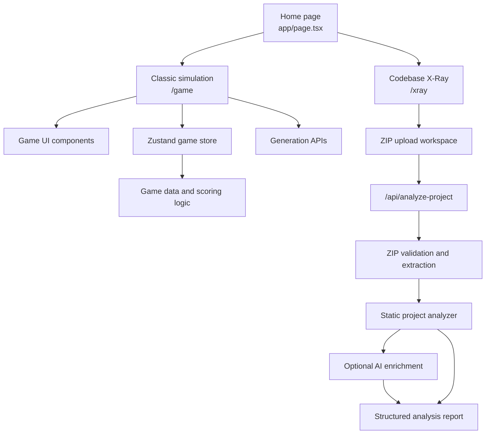

<div align="center">

# THE HACKATHON SIMULATOR

### Build. Ship. Survive.

**A two-mode workspace for building a hackathon idea from scratch or understanding an existing codebase.**

[](https://nextjs.org/)
[](https://react.dev/)
[](https://www.typescriptlang.org/)
[](https://zustand-demo.pmnd.rs/)
[](https://tailwindcss.com/)

[Explore the project](#-project-overview) · [Features](#-features) · [Setup](#-getting-started) · [API](#-api-routes)

</div>

---

## 📌 Project overview

The Hackathon Simulator is a web application built around two ways of working with hackathon projects:

1. **Classic Hackathon Simulation** — take an idea through a simulated hackathon workflow. Make product and technical decisions, assemble a team, select a solution and technology stack, prioritize features, prepare a pitch deck, receive teammate and mentor feedback, and face a judge.
2. **Codebase X-Ray** — upload a ZIP archive of an existing software project and receive a structured review of its codebase. The report covers detected technologies, project structure, important files, architecture clues, implemented and incomplete feature signals, potential issues, security findings, and improvement suggestions.

The application is designed to make the process of planning a new project and reviewing an existing one more interactive and understandable.

> **Note:** X-Ray performs source-based analysis of the files included in the uploaded archive. Its findings are signals for review, not a guarantee that the application is secure, correct, or production-ready.

## 🧭 Choose a mode

### 01 — Classic Hackathon Simulation

The simulation guides a player through decisions involved in shaping a hackathon project.

The workflow includes:

- Selecting a challenge and forming a team.
- Reviewing a problem statement and choosing a solution direction.
- Selecting a technology stack and defining a unique selling proposition (USP).
- Prioritizing features.
- Arranging a pitch deck.
- Consulting teammates and mentors.
- Choosing a business model and preparing the final pitch.
- Going through judge evaluation and reviewing the result.

The game uses a stage-based flow, decision data, scoring logic, teammate interactions, mentor hints, random events, and judge feedback. The exact outcome depends on the decisions made during a run.

### 02 — Codebase X-Ray

X-Ray is intended for an existing project rather than a new simulated idea.

**Workflow**

1. Open **Codebase X-Ray** from the home page.
2. Select or drag in a `.zip` project archive.
3. Start the analysis.
4. Review the generated report.

**The report can include:**

| Report area | What it shows |
|---|---|
| Project summary | Project name and a generated or source-derived overview |
| Languages and frameworks | Technologies detected from file extensions and project manifests |
| Dependencies | Dependencies identified from supported manifests |
| Folder structure | A view of the archive's project paths |
| Important files | Key source, configuration, test, and documentation files |
| Architecture | Detected entry points, layers, and architecture notes |
| Implemented features | Feature signals found in the available source |
| Incomplete features | Potentially unfinished or partially represented functionality |
| Potential issues | Source-based issues worth investigating |
| Security findings | Potential security concerns identified by the analysis |
| Improvement suggestions | Suggested areas to inspect or improve |

X-Ray can return one of two report modes:

- **AI-enriched** — static analysis is supplemented with an available configured AI provider.
- **Static report** — a local static-analysis report is returned when AI enrichment is unavailable or cannot be used.

The analysis is based on the contents of the uploaded archive. It does not install dependencies, run the uploaded application, execute its tests, or perform a live penetration test.

## ✨ Features

### Simulation features

- **Stage-based hackathon flow** for progressing from challenge definition to final judging.
- **Team and teammate system** with distinct specialist perspectives.
- **Mentor guidance** through contextual hints and advice.
- **Technology selection** supported by curated technology data and recommendation logic.
- **Feature prioritization** with drag-and-drop interactions.
- **Pitch deck builder** with slide-order evaluation.
- **Scoring engine** that evaluates decisions across multiple project dimensions.
- **Judge profiles and feedback** with different evaluation priorities.
- **Chaos events and modifiers** that introduce changing constraints during a run.
- **Daily challenge logic** and game-mode state handled by the game store.

### Codebase X-Ray features

- ZIP upload through file selection or drag and drop.
- Archive validation and bounded extraction.
- Detection of common programming languages and project technologies.
- Inspection of supported source and configuration files.
- Project structure and important-file summaries.
- Findings grouped by implementation, completeness, potential issues, and security.
- Optional AI enrichment with static fallback behavior.
- Upload and request limits intended to reduce resource abuse.

## 🏗️ Application architecture

The project uses the Next.js App Router. The home page provides access to the simulation and X-Ray workspaces. The simulation is primarily coordinated through the game page and Zustand store. X-Ray has a separate upload workspace, analysis API, ZIP extraction utility, and project analyzer.



### Main implementation areas

- `app/` — routes, layouts, styles, and API handlers.
- `components/game/` — simulation layout, decision, judge, problem, and result UI.
- `components/drag-drop/` — drag-and-drop interfaces for technology and feature selection.
- `components/xray/` — X-Ray upload workspace and report presentation.
- `store/` — Zustand game state and actions.
- `data/` — curated game content, judges, technologies, modifiers, and events.
- `lib/` — scoring, recommendations, generation, security, ZIP extraction, and codebase analysis.
- `types/` — shared TypeScript types.

## 🧰 Technology stack

| Technology | Role in this project |
|---|---|
| Next.js 16 | React framework, App Router, and server API routes |
| React 19 | Component-based user interface |
| TypeScript 5 | Application types and safer development |
| Zustand 5 | Simulation state management and persistence |
| Tailwind CSS 4 | Styling and responsive layouts |
| Framer Motion | Interface transitions and motion |
| dnd-kit | Drag-and-drop interactions |
| Base UI | Accessible UI primitives used by local components |
| Zod 4 | Request and payload validation |
| yauzl | Reading and extracting ZIP archives |
| Lucide React | Interface icons |
| Vercel Analytics | Application analytics integration |

## 📂 Project structure

```text
The-Hackathon-Simulator/
├── app/
│   ├── api/
│   │   ├── analyze-project/       # Codebase X-Ray analysis endpoint
│   │   ├── generate-prd/           # PRD generation endpoint
│   │   ├── generate-problem/       # Problem statement generation
│   │   ├── generate-roast/         # Judge roast / project critique
│   │   └── generate-usps/          # USP generation
│   ├── game/
│   │   └── page.tsx                # Hackathon simulation
│   ├── results/
│   │   └── page.tsx                # Results route
│   ├── xray/
│   │   └── page.tsx                # Codebase X-Ray route
│   ├── globals.css
│   ├── layout.tsx
│   └── page.tsx                    # Mode selection home page
├── components/
│   ├── drag-drop/                  # Drag-and-drop UI
│   ├── game/                       # Simulation components
│   ├── ui/                         # Reusable UI primitives
│   └── xray/                       # Upload and analysis report UI
├── data/
│   ├── architectureTemplates.ts
│   ├── chaosEvents.ts
│   ├── judgeComments.ts
│   ├── judges.ts
│   ├── mentorHints.ts
│   ├── modifiers.ts
│   ├── problems.ts
│   ├── techItems.ts
│   └── techRegistry.ts
├── lib/
│   ├── archetypes.ts
│   ├── dailyChallenge.ts
│   ├── pitchDeckEvaluator.ts
│   ├── prdGenerator.ts
│   ├── projectAnalyzer.ts
│   ├── projectStrategyGenerator.ts
│   ├── randomizer.ts
│   ├── rateLimit.ts
│   ├── recommendations.ts
│   ├── scoring.ts
│   ├── security.ts
│   ├── utils.ts
│   └── zipExtractor.ts
├── store/
│   └── gameStore.ts
├── types/
│   └── game.ts
├── next.config.ts
├── package.json
└── tsconfig.json
```

## 🚀 Getting Started

### Prerequisites

- Node.js 20.9 or later
- npm

### 1. Clone the repository

```bash
git clone https://github.com/Subhradip304/The-Hackathon-Simulator-main-feature-dual-mode-codebase-xray_86.git
cd The-Hackathon-Simulator-main-feature-dual-mode-codebase-xray_86
```

### 2. Install dependencies

```bash
npm install
```

### 3. Configure environment variables

Create a `.env.local` file in the root directory if you want to use AI-powered features.

```env
OPENAI_API_KEY=your_openai_api_key
OPENROUTER_API_KEY=your_openrouter_api_key
GEMINI_API_KEY=your_gemini_api_key
```

Add only the API keys required by the providers configured in the project. Keep your API keys private and never commit `.env.local` to GitHub.

AI-powered features may use fallback responses when API credentials are missing or a provider request fails.

### 4. Start the development server

```bash
npm run dev
```

Open [http://localhost:3000](http://localhost:3000) in your browser.

### 5. Build for production

```bash
npm run build
npm run start
```

### Available Scripts

| Command | Description |
|---|---|
| `npm run dev` | Start development server |
| `npm run build` | Build the application |
| `npm run start` | Run production server |
| `npm run lint` | Run ESLint checks |
## 🔌 API routes

The project includes the following server-side POST endpoints:

| Endpoint | Purpose |
|---|---|
| `/api/analyze-project` | Accepts a project ZIP and returns a structured X-Ray analysis report |
| `/api/generate-prd` | Generates a project requirements document from simulation state |
| `/api/generate-problem` | Generates a hackathon problem statement |
| `/api/generate-roast` | Generates judge-style feedback or a roast for a simulation run |
| `/api/generate-usps` | Generates unique selling proposition suggestions |

These routes validate incoming data and use server-side API keys. Do not expose provider keys in client-side code.

## 🛡️ X-Ray archive handling and limitations

The X-Ray upload and extraction pipeline applies limits before inspecting archive contents.

- Accepted upload format: `.zip`.
- Maximum compressed archive size: **25 MB**.
- Maximum archive entries: **1,000**.
- Maximum total extracted content: **50 MB**.
- Maximum individual extracted file size: **2 MB**.
- Common generated or dependency directories such as `node_modules`, `.git`, `.next`, `dist`, `build`, and virtual environments are skipped.
- Environment files and common private-key/credential filenames are excluded from analysis.
- Only recognized text-oriented file extensions are read as source text.

These controls help constrain archive processing. They do not make arbitrary uploaded code safe to execute. The X-Ray analyzer reads selected file contents; it does not execute uploaded scripts.

AI-enriched results depend on provider availability, valid credentials, network access, and the quality of the source material. Static findings can be incomplete or produce false positives. Review important findings manually.

## 🔐 Security notes

The repository includes server-side request validation, rate limiting, input checks, timeout handling, ZIP path validation, archive-size limits, and security-related response headers.

Security analysis from X-Ray is informational. It should not replace dependency auditing, automated testing, code review, secret scanning, or a professional security assessment.

For deployment, configure environment variables in the hosting provider's server-side environment settings. Never publish real credentials in the repository, screenshots, logs, or issue reports.

## 🧪 Quality checks

Before submitting changes, run:

```bash
npm run lint
npm run build
```

Also test the two main application paths manually:

- Start a Classic Hackathon Simulation and progress through the available stages.
- Upload a small valid project ZIP in Codebase X-Ray and inspect the resulting report.
- Test invalid file types and oversized ZIP files.
- Test X-Ray with AI credentials configured and without them to verify the applicable report behavior.

## 🤝 Contributing

Contributions and suggestions are welcome.

1. Fork the repository.
2. Create a branch: `git checkout -b feature/your-feature`.
3. Make focused changes and keep TypeScript types up to date.
4. Run linting and the production build.
5. Commit your changes: `git commit -m "feat: describe your change"`.
6. Push your branch and open a pull request.

For bug reports, include the steps to reproduce the issue, expected behavior, actual behavior, and relevant sanitized logs. Do not include API keys, private source code, or personal data.

## 📄 License

No license file was present in the supplied project archive. Add a `LICENSE` file and update this section if you intend to distribute the project under a specific open-source license.

---

<div align="center">

**THE HACKATHON SIMULATOR**

*Plan a project. Understand the code. Make better decisions.*

</div>
